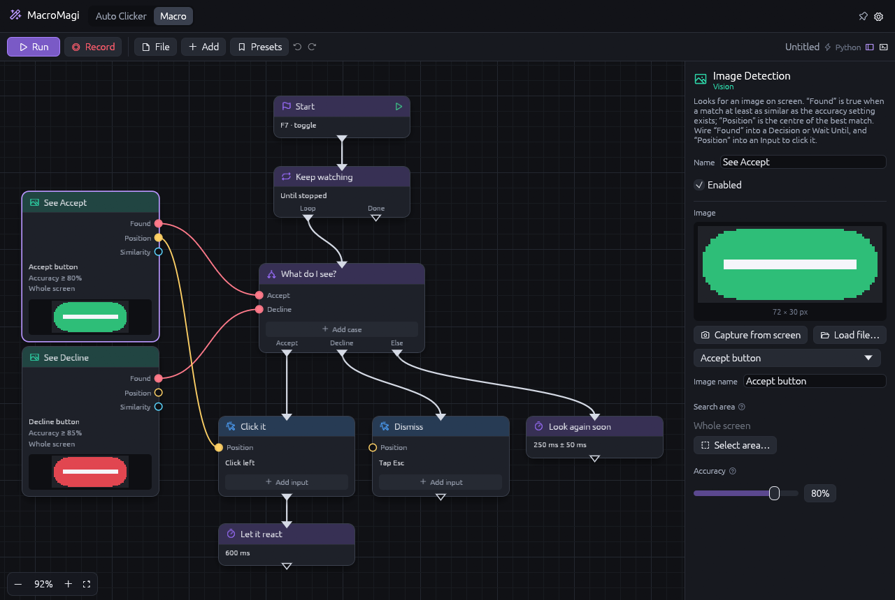
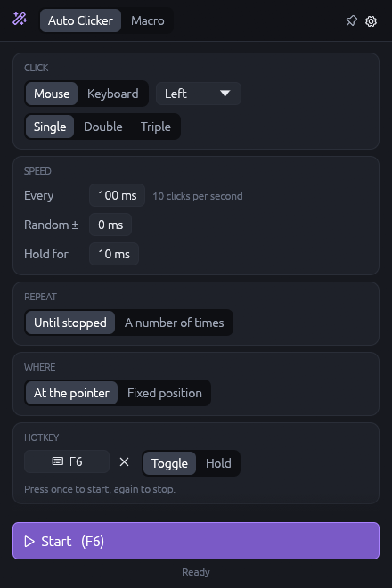
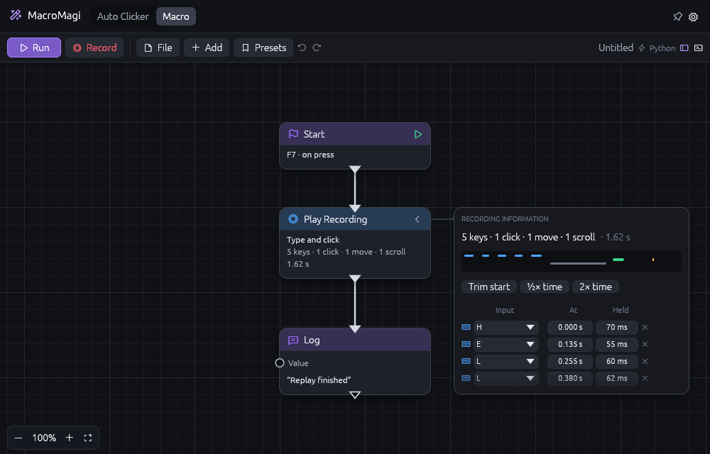

# MacroMagi

**An auto clicker when you want one click repeated, a visual macro editor when you want a bot.**

MacroMagi is a small, portable desktop tool for automating keyboard, mouse and (soon) controller input. Use the one-screen **Auto Clicker**, or switch to the **Macro** tab and wire up blocks that click, type, wait, loop, replay recordings and react to what is on screen.

[](https://github.com/MacroMagi/MacroMagi/actions/workflows/ci.yml)

<p>
  
</p>
<p>
  
  
</p>

> **Status: early development (0.1.0, unreleased).** The features below work and are covered by tests, but there are no pre-built downloads yet and things will change. Windows is the tested platform; see [Platform support](#platform-support).

## Contents

- [Features](#features)
- [Getting MacroMagi](#getting-macromagi)
- [Using it](#using-it)
  - [Auto Clicker](#auto-clicker)
  - [Macros](#macros)
  - [Recording](#recording)
  - [Reacting to the screen](#reacting-to-the-screen)
  - [Hotkeys](#hotkeys)
  - [Engines: Python and native](#engines-python-and-native)
  - [Command line](#command-line)
- [Files: `.magi` and `.mp`](#files-magi-and-mp)
- [Portable by design](#portable-by-design)
- [Platform support](#platform-support)
- [Building from source](#building-from-source)
- [Project layout](#project-layout)
- [Roadmap](#roadmap)
- [Contributing](#contributing)
- [Using MacroMagi responsibly](#using-macromagi-responsibly)
- [License](#license)

## Features

**Auto Clicker**

- Click any mouse button, or press any key, at a fixed interval – type durations the way you say them (`50ms`, `1.5s`, `2m`).
- Single, double or triple clicks; adjustable hold time; random variation so the rhythm is not mechanical.
- Run until stopped or a set number of times; click at the pointer or at a position you pick on screen.
- Start with a hotkey that toggles, or that clicks only while held.
- Save settings as presets. **Open as macro** turns the current settings into blocks you can extend.

**Macro editor**

- A node graph that reads like a flowchart: *flow goes down, values go across*.
- 14 blocks to start with – Start, Wait, Repeat, Decision, Wait Until, Stop, Log, Input, Play Recording, Image Detection, Color Detection, Logic, Random Chance and Python Script. See the [block reference](docs/NODES.md).
- Any number of **Start** blocks, each with its own hotkey, running side by side.
- **Decision** blocks with as many cases as you like, each fed by its own condition.
- One **Input** block can perform several inputs at the same time (think `Ctrl + C`, or "hold W and click").
- Blocks light up as they run; errors point at the block that caused them.
- Multi-select, copy and paste (images and recordings travel along), duplicate, disable, undo and redo, "run from here".
- Save groups of configured blocks as presets and drop them into any macro.

**Recording**

- Records keyboard, mouse buttons, mouse movement, scroll wheel and gamepad input.
- Stores *when each input was pressed and when it was released*, and replays exactly that.
- Every recorded input is listed in an editable table attached to the block: change the key, the position, the time or the hold duration, or delete it.

**Seeing the screen**

- **Image Detection** finds a picture on screen. Capture the picture by dragging a box, limit the search to an area, and set how exact the match must be from 0% to 100% (default 80%).
- **Color Detection** finds a colour, with a tolerance.
- Both give a true/false result for Decisions and a position you can wire straight into a click.

**Under the hood**

- Two interchangeable engines: **Python** (so macros can contain your own Python code) and **native Rust** (nothing to install, used automatically when Python is missing). One test suite holds both to the same behaviour.
- Hotkeys can be keyboard keys, mouse buttons or gamepad buttons, alone or combined.
- A stop-everything hotkey, and every key a macro was holding is released when it stops.
- **Dry run** mode runs a macro without sending any input and lists what it would have done.
- Portable: one executable, one `data` folder next to it, nothing else.

## Getting MacroMagi

There are no pre-built downloads yet. For now, [build it from source](#building-from-source) – it is one command once Rust is installed.

When releases start, each will be a zip per operating system: unzip anywhere and run. No installer.

## Using it

### Auto Clicker

1. Choose what to click with, how fast, and where.
2. Press **Start**, or the hotkey (`F6` by default). Press again to stop.

Everything on the tab is live: the "clicks per second" figure updates as you change the interval, and the form is locked while clicking so a stray click cannot change it.

### Macros

A macro is a graph of **blocks** joined by **wires**.

- **Flow wires** (white, top to bottom) say what happens next. A block's flow input is on its top edge, its outputs on the bottom edge.
- **Value wires** (coloured, left to right) carry a result – true/false, a screen position, a number – from one block into another.

A first macro:

1. Open the **Macro** tab. A **Start** block is already there.
2. Double-click the canvas (or right-click → *Add block*) and add an **Input** block. Drag from the bottom of Start to the top of Input.
3. Select the Input block to choose what it does. Use **Add input** to make it do several things at once.
4. Press **Run**.

Getting around the editor:

| To… | Do this |
| --- | --- |
| Add a block | Double-click the canvas, right-click → *Add block*, or drag a wire into empty space |
| Connect | Drag from one port to another |
| Disconnect | Right-click a port, right-click a wire → *Delete wire*, or `Alt`+click a wire |
| Move around | Drag with the middle or right mouse button, or hold `Space` and drag |
| Zoom | Mouse wheel; `F` fits everything in view |
| Select several | Drag a box on the canvas; `Shift`/`Ctrl`+click adds; `Ctrl+A` selects all |
| Edit a block | Select it (wide window) or double-click it (small window) |
| Copy, cut, paste, duplicate | `Ctrl+C`, `Ctrl+X`, `Ctrl+V`, `Ctrl+D` |
| Delete | `Delete` or `Backspace` |
| Undo, redo | `Ctrl+Z`, `Ctrl+Y` |
| Save, open, new | `Ctrl+S`, `Ctrl+O`, `Ctrl+N` |

*File → Examples* has three macros to take apart.

### Recording

Press **Record** (or `F9`), do the thing, press it again. A **Play Recording** block appears in the graph with its *recording information* card open, listing every input: what it was, where, when it was pressed and how long it was held. All of it can be edited.

Useful to know:

- The record and stop hotkeys are never part of a recording.
- Replay speed is a setting of the block; the recording itself can also be stretched or have its leading pause trimmed.
- Gamepad input is recorded and shown, but cannot be replayed yet ([why](#roadmap)).

> **A recording contains everything you type while it runs – including passwords.** Recordings are saved inside your `.magi` file in readable form. Check them before sharing a macro.

### Reacting to the screen

Add an **Image Detection** block, press *Capture from screen* and drag a box around the thing to look for. Then:

- wire **Found** into a **Decision** case (or a **Wait Until**) to branch on whether it is there;
- wire **Position** into an **Input** block to click it, wherever it shows up.

*Accuracy* sets how closely the screen must match: 100% means pixel-identical, 80% tolerates small rendering differences. Limiting the *search area* is faster and avoids matches elsewhere. Small, featureless images (a bare edge, a 12-pixel square) can match by accident – capture something distinctive.

If a wired Position is not available (the image was not found), the Input block is skipped rather than clicking in the wrong place.

By default MacroMagi keeps its own window out of screen captures, so it can neither hide what a macro is looking for nor end up in a captured image. That also hides it from screenshots and screen sharing; turn it off in Settings to record a tutorial.

### Hotkeys

| Hotkey | Default | Where to change it |
| --- | --- | --- |
| Start/stop the Auto Clicker | `F6` | Auto Clicker tab |
| Start a macro's Start block | none | The Start block's settings |
| Stop everything | `F8` | Settings |
| Start/stop recording | `F9` | Settings |

A hotkey can be any keyboard key, mouse button or gamepad button, or several held together. Hotkeys work while MacroMagi is minimised. The Auto Clicker hotkey is active on the Auto Clicker tab, Start-block hotkeys on the Macro tab; stop and record always.

Hotkeys are *observed*, not swallowed: the key still reaches whatever program has focus.

### Engines: Python and native

Macros can run on either of two engines. They do the same thing – the same test suite runs every scenario on both – and you can switch at any time in Settings.

| | Python engine | Native engine |
| --- | --- | --- |
| Needs | Python 3.8 or newer | Nothing |
| Python Script blocks | Yes | No |
| Used when | Python is found (the *Automatic* setting) or chosen explicitly | Python is not found, or chosen explicitly |
| Auto Clicker | – | Always |

The Python engine needs **no packages** – only the standard library. It decides what runs next and runs your scripts; the actual clicking, typing and screen reading is done by MacroMagi itself, so both engines behave identically at the device level.

MacroMagi looks for Python in this order: the interpreter chosen in Settings, a `python` folder next to the executable (for a fully portable setup), then `py -3` / `python` / `python3` on the system.

Inside a **Python Script** block you get a `magi` object:

```python
seen = magi.find_image("Accept button")      # an image of this macro, by name
if seen:
    magi.click(seen.x, seen.y)
else:
    magi.press("ctrl", "r")
    magi.sleep(500)
result = bool(seen)                          # goes out of the block's Result output
```

The full API is in [docs/PYTHON_ENGINE.md](docs/PYTHON_ENGINE.md).

### Command line

```text
macromagi [FILE.magi]              Open the editor, optionally with a macro
macromagi run FILE.magi [OPTIONS]  Run a macro without opening the window
macromagi nodes                    Print every node definition as JSON
macromagi example N FILE.magi      Save built-in example number N as a file

Options for run:
    --engine auto|python|native
    --dry-run                      Send nothing; print what would be sent
```

## Files: `.magi` and `.mp`

A **`.magi`** file is a macro. It is an ordinary ZIP archive – rename it to `.zip` to look inside:

```text
project.json        the macro: a readable text file with the blocks and wires
assets/….png        images linked from blocks
assets/….json       recordings linked from blocks
presets/….mp        presets bundled with the macro (optional)
```

A **`.mp`** file is a preset: a small JSON file holding either Auto Clicker settings or a group of configured blocks (with the images and recordings they use embedded). Presets live in `data/presets`. Turn on *Include my presets in saved .magi files* in Settings to bundle your library into the macros you save.

Both formats are specified in [docs/FILE_FORMAT.md](docs/FILE_FORMAT.md).

## Portable by design

MacroMagi has no installer and needs none.

- Everything it writes goes into a `data` folder next to the executable: `settings.json`, your `presets`, and the unpacked Python runtime.
- It writes nothing to the registry, your user profile, or anywhere else.
- Delete the folder and no trace is left.

If the folder is read-only, MacroMagi still runs; it tells you that settings cannot be saved. Set the `MACROMAGI_DATA_DIR` environment variable to keep the data somewhere else.

## Platform support

| | Status | Notes |
| --- | --- | --- |
| **Windows 10/11** | Tested | Primary platform. |
| **Linux (X11)** | Implemented, not yet tested | Wayland sessions cannot be listened to (hotkeys, recording) or injected into by the current backends. |
| **macOS** | Implemented, not yet tested | Needs the *Accessibility* permission (input) and *Screen Recording* permission (image detection). |

"Implemented, not yet tested" means the code paths exist and use cross-platform libraries, but nobody has run them yet – expect rough edges, and please [report what you find](https://github.com/MacroMagi/MacroMagi/issues).

Known limitations everywhere:

- **Sending gamepad input is not supported yet.** Gamepads can trigger macros and be recorded.
- Whole-screen searches and the screen picker use the primary monitor. A search area on another monitor works, but is clipped to that one monitor.
- On Windows, a program running as administrator ignores input from one that is not. To automate such a program, run MacroMagi as administrator too.
- Some games block synthetic input or forbid automation outright.

## Building from source

You need [Rust](https://rustup.rs). The repository pins the exact toolchain in `rust-toolchain.toml`; `rustup` installs it automatically on first build.

```bash
git clone https://github.com/MacroMagi/MacroMagi.git
cd MacroMagi
cargo build --release
```

The result is a single file: `target/release/macromagi` (`macromagi.exe` on Windows). Copy it anywhere and run it.

To run from the source tree while developing:

```bash
cargo run -p magi-app
```

**Linux** needs development headers for X11, Wayland, PipeWire and udev. On Debian or Ubuntu that is approximately:

```bash
sudo apt install pkg-config libclang-dev libx11-dev libxi-dev libxtst-dev libxcb1-dev libxrandr-dev \
    libxkbcommon-dev libwayland-dev libegl-dev libdbus-1-dev libpipewire-0.3-dev libudev-dev
```

(This list has not been verified on a clean machine yet – corrections welcome.)

Python is **not** needed to build. It is only needed at run time if you want the Python engine, and for the part of the test suite that exercises it.

Tests:

```bash
cargo test --workspace
```

More in [CONTRIBUTING.md](CONTRIBUTING.md).

## Project layout

```text
crates/
  magi-core/      The data model: graphs, block definitions, recordings, file formats. No OS or UI code.
  magi-vision/    Image matching and colour search on raw pixels.
  magi-platform/  Everything that touches the OS: sending input, listening, gamepads, screen capture.
  magi-engine/    Runs macros: the native interpreter and the bridge to Python.
  magi-app/       The desktop application (egui).
runtime/python/   The Python engine's source. Compiled into the app; unpacked on first use.
docs/             Architecture, file formats, block reference, guides.
```

Each layer only depends on the ones below it, and everything a block *is* (its ports, settings and documentation) is plain data in `magi-core`. That is what keeps features removable and is the groundwork for add-ons. [docs/ARCHITECTURE.md](docs/ARCHITECTURE.md) explains the design and where to extend it.

## Roadmap

Not promises, but the direction:

- **Add-ons.** User-made blocks, written in Python, described by the same definition format the built-in blocks use.
- **A local vision model** block: answer "is there a … on screen?" from a screenshot, a reference image or a text prompt, without sending anything to a server.
- **Sending gamepad input.** This needs a virtual controller device, which on Windows means a driver – at odds with being portable. The plan is to use one if it is already installed.
- **More blocks**: variables and counters, maths and comparisons, window focus, clipboard, sounds and notifications.
- **Editor**: comment frames and groups, a minimap, aligning and tidying, highlighting the path a run took, searching large graphs.
- **Recording**: window-relative coordinates, rescaling to another screen size, merging and splitting recordings.
- **All monitors** in the screen picker and in whole-screen searches.
- **Pre-built releases** for Windows, Linux and macOS.

## Contributing

Contributions are welcome – bug reports, platform testing (especially Linux and macOS), documentation and code. Start with [CONTRIBUTING.md](CONTRIBUTING.md); to add a block, follow [docs/ADDING_A_NODE.md](docs/ADDING_A_NODE.md).

## Using MacroMagi responsibly

MacroMagi sends real input to your computer.

- Know your stop hotkey (`F8`) before you run a macro that loops. Try unfamiliar macros with **Dry run** first.
- A `.magi` file from someone else can contain a Python Script block, which is code that runs with your permissions. Read it before you run it, exactly as you would any script.
- Automation is against the rules of many online games and services. Whether you may use it is between you and them.

## License

**No licence has been chosen yet.** Until one is added, the code is published for reading and for contributing back, but you have no licence to redistribute or reuse it. This will be settled before the first release.
